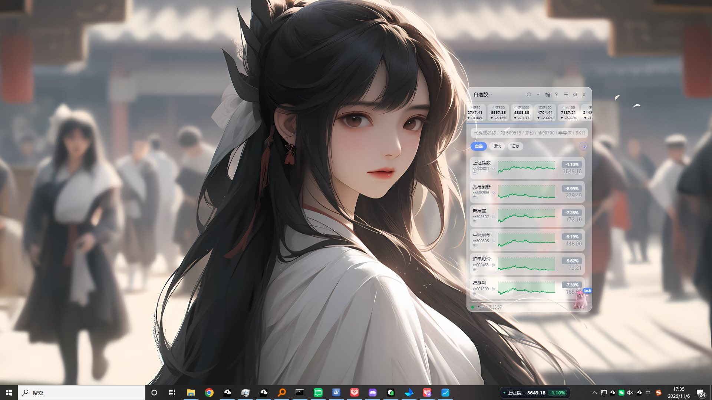
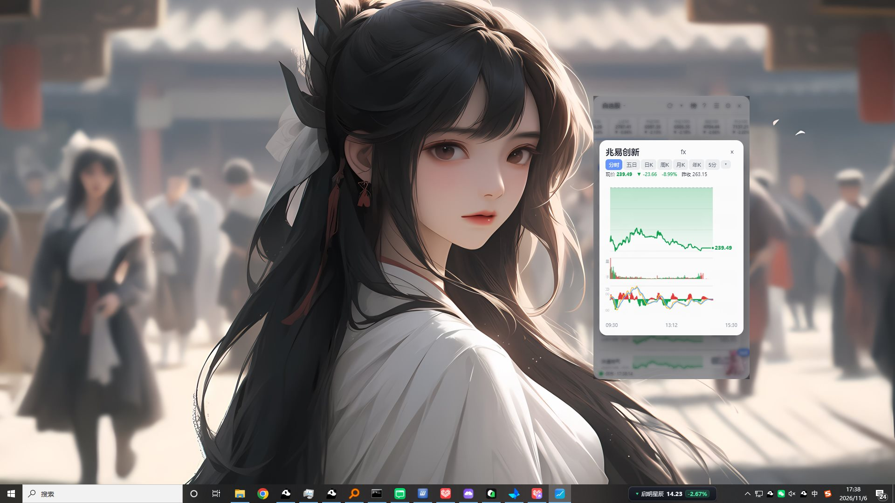
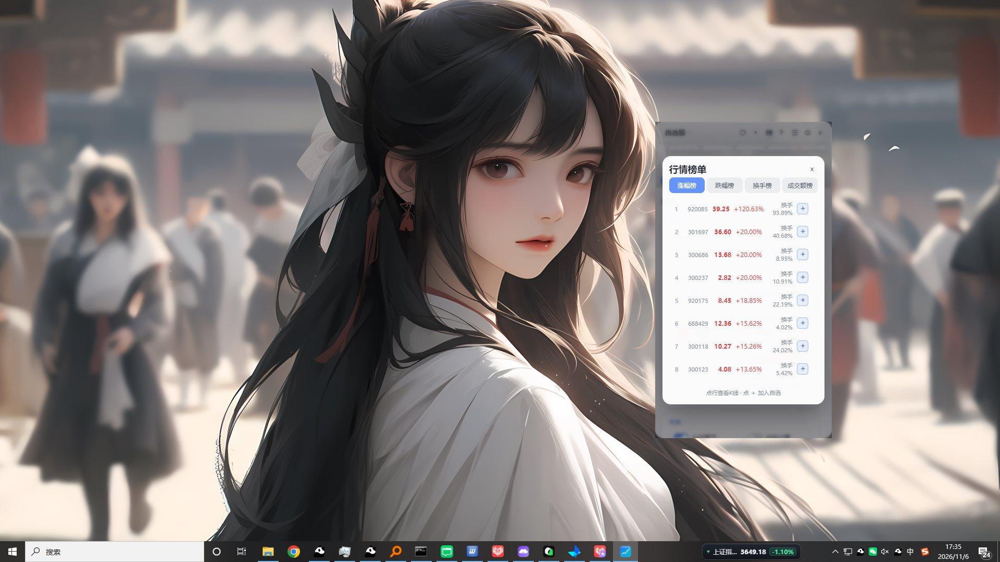
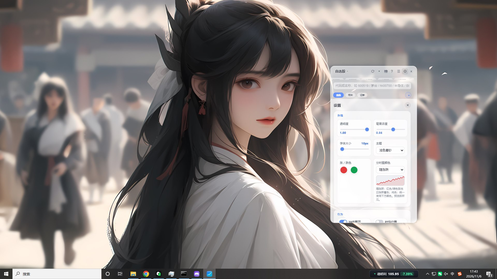

# 📈 股票自选小窗 Stock Widget

**透明置顶的桌面股票看盘挂件** —— 让自选股行情常驻桌面和任务栏，免费、免注册、开箱即用。

支持 **Windows 10 / 11 (x64)** · 数据源：腾讯财经 / 东方财富 / 新浪（公开接口，无需 API Key）

[](https://github.com/xg0001/stock-widget/releases)
[](https://github.com/xg0001/stock-widget/releases)
[](https://github.com/xg0001/stock-widget/releases)
[](LICENSE)

### ⬇️ 下载（普通用户点我就行）

[📦 **下载安装包**（推荐，双击安装）](https://github.com/xg0001/stock-widget/releases/download/v1.0.0/stock-widget-Setup-1.0.0.exe)  |  [🍃 **绿色便携版**（解压即用，免安装）](https://github.com/xg0001/stock-widget/releases/download/v1.0.0/stock-widget-v1.0.0-win64-portable.zip)

---

## 🖼️ 界面预览

| 主界面（透明悬浮 + 大盘指数条 + 分时小图） | 放大分时 / K线图 |
|---|---|
|  |  |

| 行情榜单 | 设置中心 |
|---|---|
|  |  |

## ✨ 核心亮点

| | 功能 | 说明 |
|---|---|---|
| 🪟 | **透明悬浮窗** | 毛玻璃质感、始终置顶，可叠在桌面 / 浏览器 / 游戏上，位置自动记忆 |
| 📊 | **实时行情** | A股 / 港股 / 北交所 / 板块 / 指数，红涨绿跌，价格跳动闪烁 |
| 📉 | **分时 & K线** | 每行内嵌分时小图；点开大图可切 日K / 周K / 月K，含均线、成交量、MACD |
| 🧭 | **任务栏看盘** | 常驻票以胶囊形式贴在任务栏，不切窗口随时瞄一眼（截图中右下角） |
| 🏆 | **行情榜单** | 一键查看 涨幅 / 跌幅 / 换手 / 成交额榜，点 ＋ 直接加自选 |
| 🔔 | **价格预警** | 给任意股票设高/低价，触及即弹系统通知 |
| 🐱 | **桌面宠物** | 17 只可养成的猫咪，换装 / 光效 / 每日签到攒积分 |
| ⌨️ | **全局快捷键** | 任何界面按 `Ctrl+Alt+S` 一键显隐 |
| 🖱️ | **鼠标穿透** | 开启后浮层完全不挡点击，还能贴边自动隐藏、悬停展开 |
| 🌗 | **个性化** | 浅色/深色主题、涨跌颜色、透明度、刷新频率全可调 |

## 🚀 快速上手

1. 下载上方安装包，双击安装（或解压便携版直接运行）
2. 顶部搜索框输入 **代码或中文名**（如 `600519` / `茅台` / `半导体`），回车添加
3. 拖动**标题栏**移动窗口；`Ctrl+Alt+S` 随时显隐
4. 点行内**分时小图**看大图；点标题栏 **榜** 看榜单；点 **⚙** 调设置

> 💬 官方 QQ 交流群：**1091505938**（更新提醒 & 使用攻略）

## ❓ FAQ

**Q：安装时 Windows 弹出蓝色"已保护你的电脑"提示？**
A：因为个人项目没有花 $400/年 买代码签名证书，属正常现象。点提示里的「**更多信息 → 仍要运行**」即可。源码全开放，欢迎审查。

**Q：行情是实时的吗？休市怎么办？**
A：交易时段秒级刷新（可调 1/3/5/10 秒）；休市时整行自动变灰并标注「休市」。

**Q：支持哪些市场？**
A：沪深 A股、创业板、科创板、北交所、ETF、指数、港股、行业板块（BK），均可搜索添加。

**Q：数据存哪里？会上传吗？**
A：自选股和设置只存在你本机（本地文件），软件不联网上传任何个人数据，行情请求全部走公开只读接口。

## 👨‍ 开发者：从源码运行

```bash
npm install   # 安装依赖（首次需下载 Electron，约 100MB）
npm start     # 启动小窗
npm run build # 打包 exe（见 build.cmd）
```

**项目结构**：`main.js`（主进程：窗口/托盘/快捷键/贴边吸附）、`quotes.js`（行情抓取解析）、`renderer.js` + `index.html` + `style.css`（界面与交互）、`pets.js`（宠物系统）、`tickerbar.html`（任务栏行情条）。

## 📄 License

[MIT](LICENSE) © 2026 xg0001


---

<div align="center">

## 💬 加入官方 QQ 交流群


**群号：1091505938**

扫码进群，第一时间获取版本更新与使用攻略

</div>
